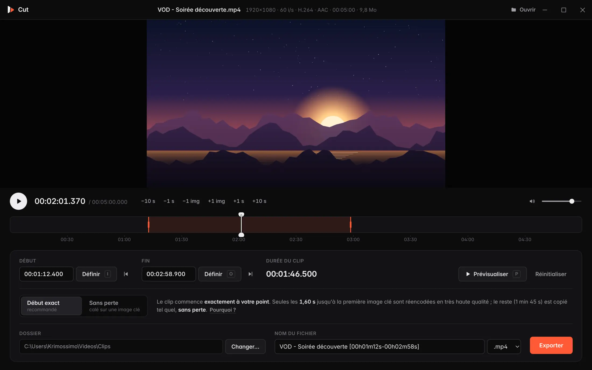

  

<h1 align="center">Cut</h1>

  <strong>Coupez vos VOD. Gardez la qualité.</strong> 
  Découpe vidéo sans réencodage pour Windows. Gratuit, FFmpeg inclus.

  <a href="https://krimossimo.github.io/Cut/"><strong>Site officiel</strong></a> ·
  <a href="https://github.com/Krimossimo/Cut/releases/latest"><strong>Télécharger</strong></a> ·
  <a href="https://ko-fi.com/krimossimo">Soutenir sur Ko-fi</a>

  

## Fonctionnalités

- **Sans réencodage** : les flux vidéo et audio sont copiés tels quels (FFmpeg `-c copy`).
- **Début exact** : seul le court passage jusqu'à la première image clé est réencodé, tout le reste est copié bit à bit.
- **Lecteur intégré** avec aperçu du passage exporté et navigation image par image.
- **Saisie au millième** : `1:02:03.5`, `95`, `1h02m03s`…
- **MP4, MKV, MOV, TS, WebM, FLV**, avec glisser-déposer.
- Installateur Windows, version portable, désinstallation propre.

## Installation

Téléchargez `Cut-Setup-x.y.z.exe` depuis les [releases](https://github.com/Krimossimo/Cut/releases/latest), puis lancez-le. Il fonctionne sous Windows 10 et 11, en 64 bits.

---

© 2026 Krimossimo. Cut utilise FFmpeg (GPL, build BtbN), Electron (MIT) et la police Inter (SIL OFL).
